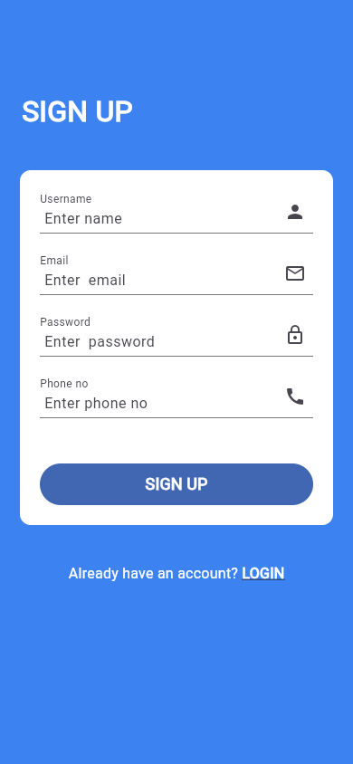
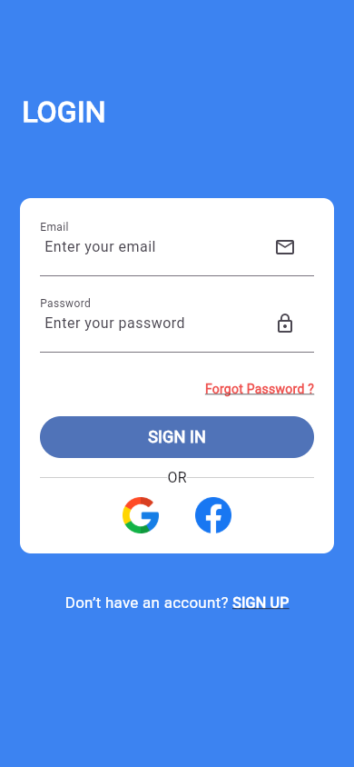
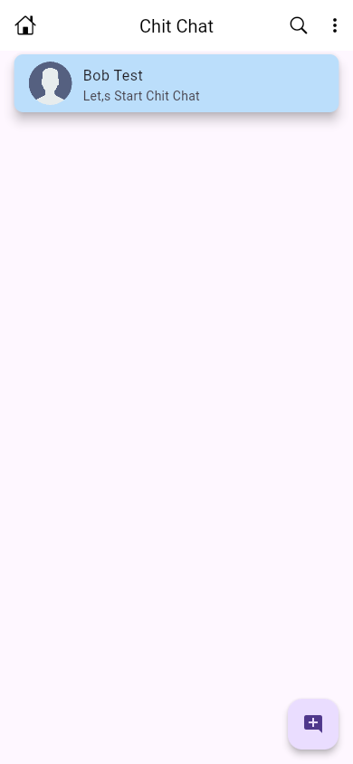
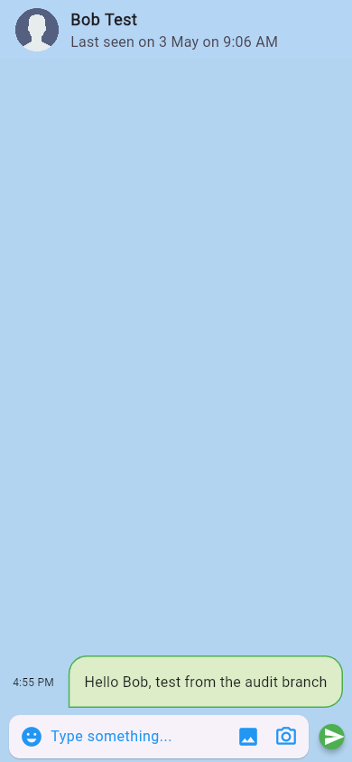

# Chat App

A one-to-one chat app built with Flutter and Firebase. Users sign up with email, add a contact by email, and exchange messages in real time through Cloud Firestore.

<p>
  
  
  
  
</p>

_Screenshots are from the web build running against a real Firebase project._

## Features

- Email sign-up and login (Firebase Auth)
- Add a contact by their email address
- Real-time one-to-one messages (Cloud Firestore)
- Image messages and profile pictures (Firebase Storage, needs Storage enabled)
- Emoji picker, save image to gallery
- Push notifications through FCM, sent by a Cloud Function (see `functions/`)
- Google Sign-In code is included but needs the Google provider enabled in Firebase

## Tech stack

| Area | Technology |
| --- | --- |
| Framework | Flutter, Dart (SDK >= 3.4) |
| Auth | firebase_auth, google_sign_in |
| Database | cloud_firestore |
| Storage | firebase_storage |
| Notifications | firebase_messaging + Cloud Function |
| Other | image_picker, emoji_picker_flutter, cached_network_image, saver_gallery, intl |

## Project structure

```
lib/
├── api/              # Firebase access (Apis)
├── features/pages/   # auth, home, chat, profile screens
├── models/
├── utils/
└── widgets/
functions/            # Cloud Function that sends push notifications
```

Firestore layout: `users/{uid}`, `users/{uid}/my_users/{contactUid}`, `chats/{conversationId}/messages/{messageId}`.

## Getting started

1. Create a Firebase project. Enable Authentication (Email/Password) and Cloud Firestore.
2. Add your Android/iOS app and put your own `google-services.json` / `GoogleService-Info.plist` in place (use `flutterfire configure` for web).
3. Firestore rules: allow reads and writes only for signed-in users, for example `allow read, write: if request.auth != null;`. Tighten per collection before going public.
4. Run:

```bash
git clone https://github.com/eslamahmedfahmy/chat_app-fully-functional.git
cd chat_app-fully-functional
flutter pub get
flutter run
```

## Push notifications

The app no longer holds a server key. Deploy the function in `functions/` (`firebase deploy --only functions`, needs the Blaze plan) so a new message triggers an FCM push using the receiver's saved token.

## Status

Verified: `flutter analyze` has 0 errors, web build runs, sign-up, add contact and sending/reading a message work against Firestore. Not verified: Android/iOS builds, push delivery, Google Sign-In, image upload.

## Author

**Eslam Fahmy** · [LinkedIn](https://www.linkedin.com/in/eslam-ahmed-fahmy-340220202)
